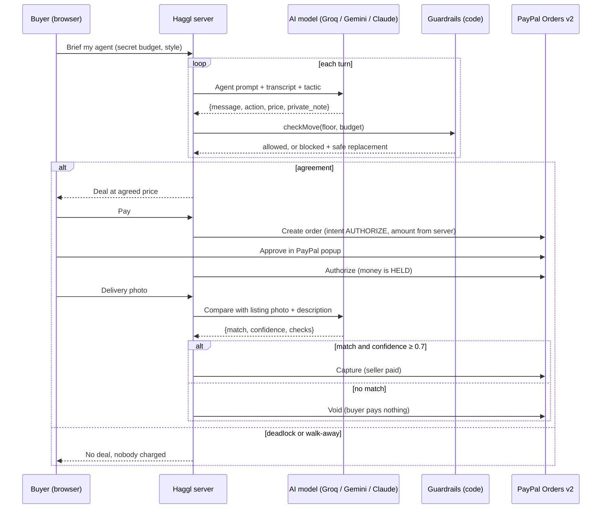

# Haggl

**Your AI haggles. PayPal holds. You pay on proof.**

Haggl is a marketplace where AI agents do the bargaining and PayPal keeps the money safe until the buyer has proof of delivery. Built for the **PayPal AI Hackathon 2026**.

**Team:** Amna Amjad · Amna Hassan · Raffay Baig

**Demo video:** _add your YouTube link here_

---

## What it does

1. **Agents negotiate.** Every listing has an AI **seller agent** that knows the seller's secret lowest price. Every buyer sends an AI **buyer agent** with a secret budget and a style (polite, tough or charming). The two bargain live until they agree, deadlock, or one walks away.
2. **PayPal holds the money.** When the agents agree, the buyer approves the price through PayPal Checkout with `intent: AUTHORIZE`. The money is held, not sent.
3. **AI verifies, then money moves.** After delivery, the buyer uploads a photo. An AI vision inspector compares it with the listing photo and description. Match: the authorization is **captured** and the seller is paid. No match: it is **voided** and the buyer pays nothing.

> **The AI can talk, but only code can move money.**
> The seller's lowest price and the buyer's budget are enforced in code, not in prompts. Even a prompt-injected or jailbroken agent cannot close a bad deal, and the amount sent to PayPal always comes from the server.

## Why it's different

| Feature | Why it matters |
|---|---|
| **Agent-to-agent negotiation** | Both sides have an agent. This is agentic commerce, not a chatbot bolted onto a checkout. |
| **Guardrails in code** | Price limits are checked in `src/guardrails.js`. The 😈 *Try to trick the seller* and 💥 *Simulate jailbroken seller* buttons show unsafe moves being blocked live. |
| **Authorize → verify → capture or void** | PayPal's hold-then-settle flow becomes AI-verified escrow for marketplaces where trust is low. |
| **Varied, human-sounding haggling** | Each turn an agent gets a different tactic and writes a private strategy note the other side never sees. Click 💭 to read it. |
| **Failed negotiations** | If the gap stops closing, Haggl calls a deadlock and ends with "No deal". Nobody is charged. |
| **Photo-to-photo inspection** | The inspector compares the delivery photo against the seller's own listing photo, and returns checks and a confidence score. |
| **Audit trail** | Every offer, block, hold, capture and void is logged with its PayPal ID. |

---

## Run it locally

You need **Node.js 18 or newer** (check with `node -v`). There is nothing to install: the project has **zero npm dependencies**.

1. Clone or download this repository and open the folder.
2. Copy `.env.example` to `.env` and fill it in:

   ```dotenv
   AI_PROVIDER=groq
   VISION_PROVIDER=groq
   GROQ_API_KEY=your-groq-key
   GROQ_MODEL=openai/gpt-oss-120b
   GROQ_VISION_MODEL=qwen/qwen3.8-27b

   PAYPAL_CLIENT_ID=your-sandbox-client-id
   PAYPAL_CLIENT_SECRET=your-sandbox-secret
   PAYPAL_ENV=sandbox
   ```

   - Groq key: console.groq.com → API Keys (free tier works).
   - PayPal keys: developer.paypal.com → Apps & Credentials → your app, in **Sandbox** mode.
3. Start the app:

   ```
   npm start
   ```
4. Open **http://localhost:3000**.

The pills in the top-right corner show what is active, for example `Groq (openai/gpt-oss-120b)` and `PayPal sandbox`. If a key is missing, that part runs in a clearly labelled **mock** mode so you can still click through the whole flow.

### Try the full flow

1. Pick an item and press **Send my agent to negotiate**.
2. During the haggle, press 😈 or 💥 to see a red **Blocked by code** card.
3. When the deal is agreed, pay with PayPal using a **sandbox personal account** (developer.paypal.com → Testing Tools → Sandbox Accounts). It is fake money.
4. Upload a photo of the right item to see **Seller paid**, or a photo of something else to see **Hold released**.
5. Open **Seller dashboard** to see every negotiation, payout, released hold and blocked move.
6. Use **Sell** to list your own item with a photo and a secret lowest price.

### Other AI providers

Set `AI_PROVIDER` (the agents) and `VISION_PROVIDER` (the photo check) to `groq`, `gemini` or `anthropic`, fill in that provider's key and model in `.env`, and restart. No code changes are needed.

### Troubleshooting

- **"Model does not exist":** providers rename models. Put a current model name in `GROQ_MODEL`, `GROQ_VISION_MODEL` or `GEMINI_MODEL`. The vision model must accept images.
- **Rate limits (429):** on a free tier the app waits and retries by itself, so a negotiation may pause for a few seconds.
- **Yellow "AI error, backup logic" tag:** one AI call failed and scripted logic stepped in. Hover over the tag to see the error.
- **PayPal auth failed:** the Client ID or Secret is wrong, or they are Live keys instead of Sandbox keys.
- **PayPal error during payment:** developer.paypal.com → Event Logs shows the exact API error.

---

## How it works



### Tech stack

- **PayPal:** Orders v2 API (`intent: AUTHORIZE`), Payments v2 authorizations (capture and void), JavaScript SDK buttons, sandbox.
- **AI:** Groq (`openai/gpt-oss-120b` for the agents, `qwen/qwen3.8-27b` for vision). Google Gemini and Anthropic Claude are supported through the same interface.
- **Backend:** Node.js with no framework and no dependencies. JSON-file storage.
- **Frontend:** plain HTML, CSS and JavaScript. No build step.

### Project layout

```
server.js            HTTP server and API routes
src/agents.js        Agent prompts, per-turn tactics, turn engine, deadlock detection
src/guardrails.js    Floor and budget enforcement, agreement detection
src/paypal.js        OAuth, create order (AUTHORIZE), authorize, capture, void
src/verify.js        AI vision delivery inspector
src/ai.js            Groq, Gemini and Anthropic through one interface
src/db.js            JSON-file storage in data/
src/seed.js          Demo listings and photos
public/              Front end
docs/                Demo video script and Devpost write-up
```

### API

| Method | Path | What it does |
|---|---|---|
| GET | `/api/config` | Active AI provider and PayPal mode |
| GET, POST | `/api/listings` | List or create listings (the lowest price is never returned) |
| POST | `/api/deals` | Start a negotiation |
| POST | `/api/deals/:id/next` | Run one agent turn |
| POST | `/api/deals/:id/inject` | Queue a human-typed trick message (demo) |
| POST | `/api/deals/:id/jailbreak` | Make the seller's next move act compromised (demo) |
| POST | `/api/deals/:id/order` | Create the PayPal order (intent AUTHORIZE) |
| POST | `/api/deals/:id/authorize` | Authorize after buyer approval (hold) |
| POST | `/api/deals/:id/verify` | AI checks the delivery photo, then capture or void |
| GET | `/api/deals` | Seller dashboard data |

---

## Deploy on Render

1. Push this project to GitHub. The `.gitignore` keeps `.env` and `data/` out of the repository.
2. On render.com choose **New → Web Service** and pick the repository.
3. Runtime **Node**, build command `npm install`, start command `npm start`.
4. Under **Environment**, add the same keys as your `.env`.
5. Deploy. On the free plan, demo data resets when the service restarts.

## Limits

- This is a demo: storage is a JSON file and there are no user accounts. The seller dashboard is open so judges can see the guardrails working.
- Sandbox only. Going live would need seller onboarding (for example PayPal multiparty), shipping tracking and dispute handling.
- AI photo verification is an aid for low-value goods, not a guarantee. Disputes would still go through PayPal.

## AI tools used

- **In the product:** Groq-hosted models run the negotiating agents and the delivery inspector.
- **During development:** we used an AI coding assistant (Claude) to help write and debug the code.

## Team

- **Amna Amjad**
- **Amna Hassan**
- **Raffay Baig**

## License

MIT. See [LICENSE](LICENSE).
