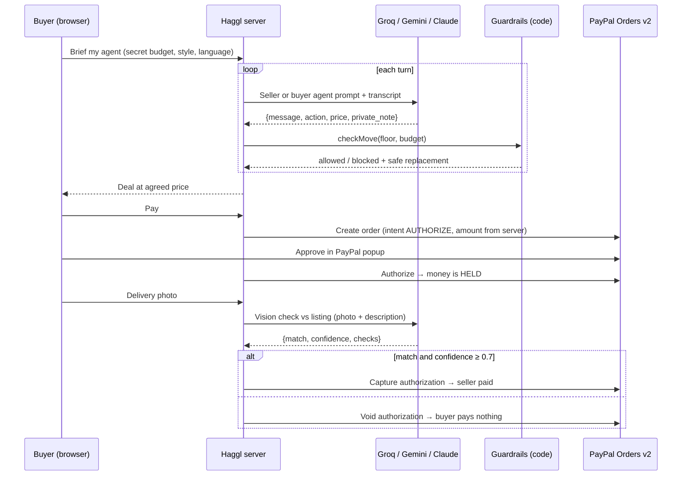

# Haggl: your AI haggles. PayPal holds. You pay on proof.

On **Haggl**, every listing has an AI **seller agent** and every buyer sends an AI **buyer agent**. The two bargain live, like a real market. If the numbers can never work, the negotiation fails cleanly and nobody is charged. When they agree, **PayPal holds the money** (an authorization). The seller is paid only after an **AI inspector checks the buyer's delivery photo**. If the item doesn't match, the hold is voided and the buyer pays nothing.

> **The AI can talk, but only code can move money.**
> The seller's secret lowest price and the buyer's secret budget are enforced in code, not in prompts.
> Even a tricked or jailbroken agent cannot close a bad deal.

---

## Run it on your laptop (about 5 minutes)

You need **Node.js 18 or newer** (check with `node -v`). There is **nothing to `npm install`**: the project has zero dependencies.

1. Unzip the project and open the `haggl` folder in VS Code.
2. Copy `.env.example` and rename the copy to `.env`.
3. Open `.env` and paste in your keys:
   - An AI key: `GROQ_API_KEY` (console.groq.com), `GEMINI_API_KEY` ([Google AI Studio](https://aistudio.google.com)) or `ANTHROPIC_API_KEY`, and set `AI_PROVIDER` to `groq`, `gemini` or `anthropic`
   - `PAYPAL_CLIENT_ID` and `PAYPAL_CLIENT_SECRET`: from developer.paypal.com → Apps & Credentials → your app (Sandbox)
4. In VS Code open a terminal (**Terminal → New Terminal**) and run:
   ```
   npm start
   ```
5. Open **http://localhost:3000** in your browser.

The top-right pills show what's active, e.g. `Groq (llama-3.3-70b-versatile)` and `PayPal sandbox`.
If a key is missing, that part runs in a clearly-labelled **mock** mode so you can still click through everything.

### Paying in the sandbox
When the PayPal popup opens, log in with your **sandbox personal account** (developer.paypal.com → Testing Tools → Sandbox Accounts → the `@personal.example.com` one → View/Edit account shows the password). It's fake money.

### Switch AI provider
Change `AI_PROVIDER` in `.env` to `groq`, `gemini` or `anthropic` (with that provider's key filled in), stop the server (Ctrl+C) and run `npm start` again. No code changes.

### Use Groq instead
Get a key at console.groq.com → API Keys. In `.env`, paste `GROQ_API_KEY=...` and set `AI_PROVIDER=groq`, then restart. If Groq says a model doesn't exist, check console.groq.com/docs/models and update `GROQ_MODEL` (negotiation) or `GROQ_VISION_MODEL` (photo check; it must support images).

### If something breaks
- **Gemini 404 / model not found:** Google renames models. Put a current model name from AI Studio in `GEMINI_MODEL`.
- **Gemini 429:** free-tier rate limit. Wait a minute, or press Faster less often.
- **PayPal auth failed:** the Client ID/Secret are wrong, or they're from Live instead of Sandbox.
- **PayPal error during payment:** open developer.paypal.com → Event Logs; it shows the exact API error.
- A yellow **"AI error, backup logic"** tag on a message means one AI call failed and scripted logic stepped in so the demo keeps going. Hover it to see the error.

---

## How it works



### What makes it different
| Feature | Why it matters |
|---|---|
| **Agent-to-agent negotiation** | Agentic commerce where both sides have an agent, not just a chatbot checkout. |
| **Guardrails in code** | Floor price and budget are checked in `src/guardrails.js`. The demo's 😈 *Try to trick the seller* (prompt injection) and 💥 *Simulate jailbroken seller* buttons show the code blocking unsafe moves. |
| **Authorize → verify → capture/void** | Uses PayPal's hold-then-settle flow as AI-verified escrow for marketplaces where trust is low. |
| **Private thoughts & tactics** | Every turn each agent gets a different negotiating tactic (point out a flaw, offer an extra, threaten to walk...) and writes a strategy note the other side never sees. Click 💭 to watch the agents think. |
| **Failed negotiations** | If the gap stops closing (e.g. budget below the seller's secret floor), Haggl detects the deadlock and ends with "No deal", showing the final gap. Agents can also walk away. |

| **Server-side amounts** | The price sent to PayPal always comes from the server's record of the deal, never from the browser. |
| **Audit trail** | Every offer, block, hold, capture and void is logged with PayPal IDs. |

### Project layout
```
server.js            HTTP server + API routes (no framework)
src/agents.js        Agent prompts, per-turn tactics, turn engine, deadlock detection, backup logic
src/guardrails.js    Floor/budget enforcement, agreement detection
src/paypal.js        OAuth, create order (AUTHORIZE), authorize, capture, void
src/verify.js        AI vision delivery inspector
src/ai.js            Groq, Gemini and Anthropic via plain fetch, one interface
src/db.js            JSON-file storage in data/
public/              Front end (vanilla JS, no build step)
docs/                Demo video script, Devpost write-up draft
```

### API
| Method | Path | What it does |
|---|---|---|
| GET | `/api/config` | Active AI provider, PayPal mode |
| GET/POST | `/api/listings` | List / create listings (floor price never returned) |
| POST | `/api/deals` | Start a negotiation |
| POST | `/api/deals/:id/next` | Run one agent turn |
| POST | `/api/deals/:id/inject` | Queue a human-typed trick message for the buyer side |
| POST | `/api/deals/:id/jailbreak` | Make the seller's next move act fully compromised (demo) |
| POST | `/api/deals/:id/order` | Create PayPal order (intent AUTHORIZE) |
| POST | `/api/deals/:id/authorize` | Authorize after buyer approval (hold) |
| POST | `/api/deals/:id/verify` | AI checks delivery photo → capture or void |
| GET | `/api/deals` | Seller dashboard data |

---

## Deploy on Render
1. Put the project on GitHub (the `.gitignore` already keeps `.env` and `data/` out). Easiest way: create a new repository on github.com → **uploading an existing file** → drag in everything except `.env`.
2. On render.com: **New → Web Service** → pick the repo.
3. Runtime **Node**, Build command: `npm install` (it installs nothing, which is fine), Start command: `npm start`.
4. Under **Environment**, add the same keys as your `.env` (e.g. `AI_PROVIDER`, `GROQ_API_KEY`, `GROQ_MODEL`, `GROQ_VISION_MODEL`, `PAYPAL_CLIENT_ID`, `PAYPAL_CLIENT_SECRET`, `PAYPAL_ENV=sandbox`).
5. Deploy. Note: on the free plan, demo data resets when the service restarts.

## Limits (honest list)
- Demo storage is a JSON file; there are no user accounts. The seller dashboard is open so judges can see the guardrails work.
- Sandbox only. Going live would need seller onboarding (e.g. PayPal multiparty), shipping tracking and dispute handling.
- AI verification is an aid for low-value goods, not a guarantee. Disputes would still go through PayPal.

MIT licence.
